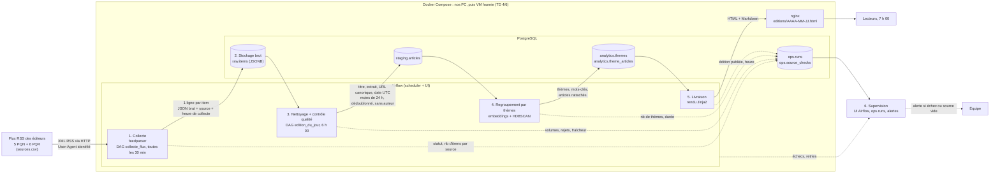

# La gazette — architecture

## Ce qui circule entre les boîtes

| De → vers | Contenu | Où |
|---|---|---|
| Éditeurs → 1. Collecte | XML RSS 2.0 | HTTP, User-Agent identifié, `robots.txt` respecté |
| 1 → 2. Brut | L'item tel que reçu (JSONB), source, `collected_at` | `raw.items`, insertion seule, rejouable |
| 2 → 3. Nettoyage | Items collectés depuis 24 h | lecture SQL |
| 3 → 4. Regroupement | `source, titre, extrait, url_canonique, published_at (UTC)`, sans auteur | `staging.articles`, `url_canonique UNIQUE` |
| 4 → 5. Livraison | Thèmes (libellé par mots-clés, taille, sources) et articles rattachés | `analytics.*` |
| 5 → lecteurs | Édition du jour : thèmes, titres, liens | `editions/AAAA-MM-JJ.html` et `.md` |
| Toutes → 6. Supervision | Statut, durée, volumes par source, rejets | `ops.*` et UI Airflow |

## Où ça tourne et quand

| Traitement | Déclencheur | Pourquoi |
|---|---|---|
| `collecte_flux` | toutes les 30 min | Certains flux ne gardent que la dernière heure (Ouest-France : 10 articles) |
| `edition_du_jour` | 6 h 00 Europe/Paris, retries jusqu'à 6 h 45 | Laisser une marge avant la sortie de 7 h |

Tous les conteneurs (Postgres, Airflow, nginx) sont décrits dans `docker-compose.yml` (TD 2). Ils tournent sur nos PC, puis sur la VM fournie pour la mise en production.
